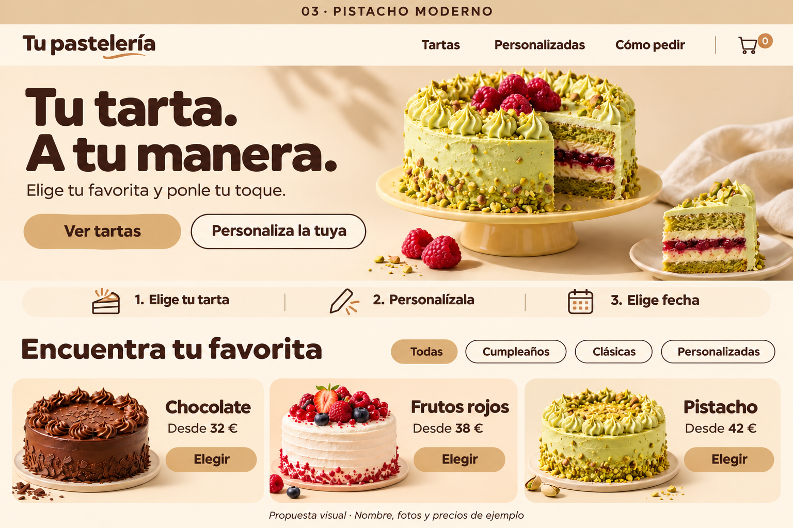

# Vainelú · documentación completa para Codex

Versión 1.0 · 7 de noviembre de 2026

Este documento reúne las siete especificaciones del paquete. Los archivos individuales de docs son la fuente mantenida. El encargo conserva **Vainelú** y el diseño crema aprobado. Esta entrega contiene documentación, una referencia y configuración de ejemplo; la aplicación y sus pruebas están pendientes de implementación.

Para iniciar, leer README.md y pegar INICIAR_EN_CODEX.txt en Codex con el paquete completo disponible. Las reglas de proyecto están en AGENTS.md. Las propuestas técnicas y los datos demo están identificados como tales.

## Referencia aprobada

La lámina conserva el nombre provisional y las anotaciones originales. En la implementación se sustituye «Tu pastelería» por **Vainelú** y se omiten las bandas de presentación. Mantener el diseño crema, la jerarquía y la composición.

## Contenido

1. Decisiones y alcance.
2. Diseño y componentes.
3. Requisitos y flujos.
4. Arquitectura y datos.
5. Plan y aceptación.
6. Operación y entrega.
7. Fuentes técnicas.

Los JSON, CSS, variables y plantillas permanecen en sus archivos del paquete para poder utilizarlos directamente.

---

## Decisiones y alcance de Vainelú

### Propósito

Desarrollar una tienda web de un único negocio para vender tartas bajo la marca Vainelú. La experiencia debe permitir comprender el producto, personalizar lo que se compra y elegir una fecha realmente disponible. La apariencia de la portada debe proceder de la referencia aceptada, no de una nueva interpretación visual.

### Qué está confirmado

| Decisión | Evidencia en esta conversación | Aplicación |
| --- | --- | --- |
| Web de venta de tartas | «Diseñamos una pagina para vender tartas» | Tienda web de un solo negocio |
| Diseño seleccionado | El usuario adjuntó el tercer diseño y pidió «Quiero cambiar los tonos a crema» | Usar la edición crema del diseño de pistacho |
| Aceptación de la edición | «Me gusta» después de la imagen crema | Mantener su composición, carácter y paleta |
| Marca definitiva para desarrollar | «Dejamos vainelu» | Mostrar Vainelú, con tilde |
| Entrega actual | «prepara la documentación para códex» | Preparar el encargo, no afirmar que la tienda ya existe |

Los otros nombres y los otros siete estilos quedan descartados para esta implementación. La decisión de nombre no equivale a una comprobación de registro de marca o disponibilidad de dominio.

### Propuesta funcional para la primera versión

Se propone implementar portada y catálogo, fichas de producto, opciones de personalización, carrito, elección de fecha, recogida o entrega configurables, compra como invitado, confirmación y consulta privada del pedido. Un panel para el propietario permitirá gestionar productos, precios, agenda, capacidad y pedidos.

La compra debe ser un flujo completo y comprobable. Los botones de la maqueta han de convertirse en acciones reales dentro del alcance del entorno: demostración claramente identificada o integración de pruebas con persistencia. Una interfaz que únicamente cambia de pantalla no acredita una tienda operativa.

Para solicitudes fuera del catálogo se propone un formulario de presupuesto. Esas solicitudes no se cobrarán automáticamente ni consumirán capacidad de producción hasta que se conviertan en un pedido aceptado según el flujo definido. En esta primera versión, cerrar el presupuesto puede gestionarse administrativamente; no se requiere construir un sistema complejo de negociación.

### Entornos y alcance comercial

| Modo | Uso | Datos y cobro |
| --- | --- | --- |
| `demo` | Revisar el diseño y ensayar el recorrido sin credenciales | Datos ficticios; almacenamiento local aislado; nunca pago ni pedido real |
| `test` | Verificar la tienda con servicios conectados | Base de datos separada de producción y Stripe en sandbox o modo de prueba; datos sintéticos |
| `production` | Vender a clientes reales cuando se active | Solo después de completar configuración comercial e integraciones y validar el flujo |

El diseño debe ser el mismo en los tres modos. En demo y test habrá una indicación clara y discreta del entorno, por ejemplo «Demostración · No se realizan pedidos ni cobros reales». Esta indicación no debe confundirse con las bandas de presentación de la maqueta.

La implementación que se encargará a Codex empieza en desarrollo y pruebas. El encargo no autoriza por sí solo comprar dominios, contratar servicios, enviar mensajes a terceros, utilizar tarjetas reales ni abrir ventas. Preparar los puntos de integración sí forma parte del trabajo.

### Valores iniciales propuestos

- Idioma de la interfaz: español de España.
- Moneda inicial: EUR, guardando dinero como enteros en céntimos.
- Zona horaria comercial inicial: Europe/Madrid, configurable y pendiente de confirmar con el negocio.
- Compra como invitado; autenticación obligatoria para administración.
- Pago total al hacer el pedido en el flujo de catálogo conectado. Presupuestos especiales separados y sin cobro inicial.
- Tarjeta como primera integración mediante Checkout alojado. Los monederos se mostrarán únicamente si el proveedor, el dispositivo y la configuración los admiten y se han comprobado; no anunciar disponibilidad garantizada.
- Recogida y reparto serán funciones configurables. No activar un método real sin dirección, calendario o zonas y tarifas válidas.
- Sin cuenta de cliente obligatoria, suscripciones, marketplace, programa de puntos ni aplicación móvil nativa en esta primera versión.

Estos valores permiten trabajar sin esperar por cada detalle. Deben residir en configuración o datos y quedar documentados para poder cambiarlos sin rediseñar la web.

### Datos comerciales que faltan

Faltan identidad fiscal y nombre del titular, datos de contacto, dirección, catálogo real, precios por variante, recetas e información de alérgenos verificada, fotos reales de producto, horarios, plazos de preparación, capacidad diaria, zonas y tarifas de reparto, política de pedidos y cancelación, tratamiento fiscal aplicable, condiciones de venta y textos de privacidad.

`config/business.example.json` deja estos campos sin completar. Los valores de `config/demo.settings.json` y `config/catalogo.demo.json` sirven exclusivamente para comprobar la interfaz y las reglas. No se convierten en datos de producción mediante un simple cambio del nombre del archivo.

### Fuera del alcance inicial

No se pide TPV de restaurante, comandero, integración de impresoras, gestión de mesas, APK, app de iPhone, marketplace de pasteleros, inventario de ingredientes, cálculo nutricional automático ni facturación certificada. Tampoco se incluyen promociones, valoraciones de clientes, reseñas o contadores de ventas inventados. Las nuevas funciones se evaluarán después de que el recorrido esencial esté completo.

### Orden de prioridades

1. Fidelidad visual y navegación clara.
2. Catálogo y personalización consistentes, con precio y cantidades correctos.
3. Agenda y capacidad verificadas por servidor.
4. Pedidos compartidos y pagos de prueba confirmados correctamente.
5. Administración utilizable y pruebas documentadas.
6. Configuración comercial y preparación para una futura apertura real.

Si hay una duda reversible de implementación, Codex debe escoger una solución razonable, registrarla y continuar. Si falta una credencial o un dato comercial, debe completar lo independiente y señalar el bloqueo concreto; no sustituirlo por un éxito ficticio.

---

## Diseño y componentes de Vainelú

### Dirección aprobada

La referencia es [diseno_aprobado_crema.png](referencias/diseno_aprobado_crema.png). Mantener su carácter cercano, redondeado y centrado en las tartas. La fotografía y el titular dominan la primera pantalla. La tienda debe reconocerse como la misma propuesta que el propietario aceptó.

La lámina mide 1536 × 1024 px e incluye una franja superior de presentación. Al eliminar esa franja, el contenido de la web comienza antes: no añadir un hueco para conservar artificialmente las coordenadas de la imagen. La nota inferior tampoco forma parte de la tienda. Consultar [LEER_REFERENCIA.md](referencias/LEER_REFERENCIA.md).

### Paleta inicial

Estos valores son una aproximación técnica propuesta a partir de la imagen, no colores extraídos de un archivo de diseño original. Ajustarlos con comparación visual, conservando su familia y el contraste.

| Token | Valor propuesto | Aplicación |
| --- | --- | --- |
| cream | #FFF8EC | Fondo principal |
| cream-surface | #F4E4CC | Superficies suaves, franja de pasos |
| sand | #E9D5B6 | Bordes y fondos secundarios |
| caramel | #D8B78C | Botón principal y categoría activa |
| cocoa | #422C21 | Texto, iconos y bordes de controles |
| caramel-dark | #9C6238 | Detalles decorativos y estados de interacción |

El texto de botones caramelo debe ser cacao. No usar texto blanco pequeño sobre caramelo. Los bordes que permitan reconocer un control deben distinguirse de su fondo. Para texto normal, comprobar al menos 4,5:1; para texto grande, 3:1, siguiendo [WCAG 2.2, contraste mínimo](https://www.w3.org/WAI/WCAG22/Understanding/contrast-minimum.html). Los estados de error o éxito pueden emplear colores semánticos discretos y texto explicativo.

La comida conserva sus colores naturales. El verde del pistacho, el rojo de las frutas y el marrón del chocolate no amplían la paleta de navegación. Evitar filtros sepia sobre imágenes.

### Tipografía e identidad

Usar una tipografía de titulares redondeada, robusta y amable. Como aproximación de implementación se propone **Fredoka** en peso 600–700 para marca y titulares, y **Nunito Sans** para texto y formularios. La fuente exacta de la imagen no se conoce; evaluar la semejanza de las formas y sustituir la propuesta si una fuente disponible se aproxima mejor. Registrar licencia y archivos utilizados. Si una descarga falla, continuar con una pila de reserva y declarar la diferencia.

Vainelú se escribe con tilde en el logotipo textual, títulos, metadatos y comunicaciones de interfaz. Usar vainelu en slugs y nombres técnicos. Conservar el pequeño gesto curvo caramelo bajo la marca si se reproduce como decoración sencilla. No añadir un símbolo nuevo que altere su identidad.

Escala orientativa: cuerpo 16–18 px; navegación y botones 18–24 px en escritorio; titular principal mediante un tamaño fluido entre 44 y 96 px según anchura. Ajustar métricas para conservar las dos líneas «Tu tarta.» y «A tu manera.» en escritorio, sin forzar desbordamientos en móvil. Interlineado compacto en titulares y cómodo en párrafos.

### Composición de escritorio

La referencia utiliza casi todo el ancho con márgenes laterales de aproximadamente 24–48 px y espacios consistentes. Proponer un contenedor máximo cercano a 1488 px, sin convertirlo en una columna estrecha a 1536 px.

#### Cabecera

Marca a la izquierda. A la derecha, «Tartas», «Personalizadas» y «Cómo pedir», seguidos de cesta con contador. Altura orientativa 80 px. La cesta muestra la suma de unidades; su nombre accesible debe anunciar el número. Los enlaces llevan a secciones o rutas reales. La navegación no necesita hacerse fija en esta primera versión.

#### Portada

Bloque de aproximadamente 420 px de alto en la referencia. Texto en la mitad izquierda y tarta protagonista en la mitad derecha, con continuidad de fondo crema y sombras naturales. La fotografía tiene protagonismo suficiente para mostrar cobertura, corte y relleno; evitar una miniatura enmarcada aislada.

Texto exacto de partida:

- Titular: «Tu tarta. A tu manera.»
- Apoyo: «Elige tu favorita y ponle tu toque.»
- Acción principal: «Ver tartas».
- Acción secundaria: «Personaliza la tuya».

Botones anchos, redondeados, aproximadamente 64–70 px de alto en escritorio. Principal caramelo con texto cacao; secundario crema con borde cacao. Mantener espacio entre ambos y estados de foco, pulsación, carga y deshabilitado. La imagen no debe tapar texto ni reducir el contraste.

#### Pasos

Franja suave con extremos redondeados y tres bloques equilibrados: «1. Elige tu tarta», «2. Personalízala», «3. Elige fecha». Iconos de trazo cacao con detalle caramelo: porción, lápiz y calendario. Son explicación del proceso, no un asistente interactivo si no hay pasos activos. Los iconos redundantes pueden ocultarse a lectores de pantalla.

#### Catálogo

Título «Encuentra tu favorita» a la izquierda y categorías a la derecha, en la misma línea cuando haya espacio. Categorías: «Todas», «Cumpleaños», «Clásicas», «Personalizadas». La seleccionada tiene fondo caramelo; las demás, fondo crema y borde cacao. Usar botones de filtro con estado seleccionado accesible.

Tres tarjetas por fila en escritorio, cada una con imagen a la izquierda y nombre, precio y «Elegir» a la derecha. Mantener esta composición horizontal, esquinas amplias y fondo cálido. No sustituirla por una rejilla genérica de fotos encima del texto. Nombres y precios de referencia: Chocolate, desde 32 €; Frutos rojos, desde 38 €; Pistacho, desde 42 €. Son ejemplos, reemplazables por datos reales sin rediseñar las tarjetas.

La fotografía de cada tarjeta ocupa aproximadamente la mitad. Los títulos deben poder envolver líneas cuando lo necesiten. Evitar anidar un botón dentro de un enlace: implementar tarjeta y acción con una estructura HTML válida y un orden de teclado claro.

### Adaptación a tableta y móvil

La referencia de escritorio es la única maqueta aprobada. Esta adaptación es una propuesta funcional que debe enseñarse en capturas.

| Anchura de comprobación | Comportamiento propuesto |
| --- | --- |
| 1536 px | Cabecera extendida, portada a dos columnas, tres pasos en línea y tres tarjetas horizontales |
| 768 px | Menú compacto si la navegación no cabe; ajustar portada y usar dos columnas de catálogo cuando cada tarjeta sea legible |
| 390 px | Marca, menú y cesta; portada apilada con texto, acciones y fotografía; tarjetas en una columna y filtros que puedan envolver |

Elegir puntos de ruptura por el contenido, no por una etiqueta de dispositivo. En móvil, apilar los botones si no caben completos; mantener el principal antes del secundario. La franja de pasos puede convertirse en tres filas. Evitar desplazamiento horizontal de toda la página. Usar una altura natural de contenido y no recortar el titular para imitar la proporción del escritorio.

Proponer controles táctiles de al menos 44 × 44 px como objetivo del diseño, texto base de al menos 16 px, foco visible y soporte de teclado. Esta dimensión táctil es una decisión del proyecto, no una afirmación sobre el mínimo normativo de WCAG. Respetar movimiento reducido.

### Extensión del diseño al resto de pantallas

Ficha, cesta, fecha, confirmación y formularios utilizan los mismos tokens, tipografía, radios y botones. En escritorio, la ficha puede situar fotos a la izquierda y configuración a la derecha; la cesta mantiene un resumen visible. En móvil se apilan en orden de lectura. El panel del propietario prioriza legibilidad y tablas o listas claras, conservando la identidad sin copiar el gran titular de la portada.

Añadir un pie discreto con enlaces de contacto, condiciones y privacidad cuando exista contenido válido. No inventar teléfonos, direcciones o perfiles. La demostración puede indicar que esos datos están pendientes; producción no debe mostrar enlaces sin destino.

### Imágenes y rendimiento

La maqueta no contiene archivos originales separados de cada tarta. Preparar imágenes independientes autorizadas y coherentes; registrar qué es una imagen generada y qué procede del negocio. Conservar la referencia intacta. No presentar un recorte de interfaz con rótulos como foto de producto.

Reservar dimensiones de imagen para evitar saltos, servir formatos y tamaños adecuados, priorizar la imagen protagonista y diferir imágenes fuera de pantalla cuando proceda. Describir la tarta en el texto alternativo cuando aporte información; una imagen duplicada decorativa no necesita repetir el nombre de producto.

### Componentes mínimos y comprobación

Construir cabecera, navegación móvil, cesta con contador, portada, botón principal y secundario, franja de pasos, filtro de categoría, tarjeta horizontal, selector de variantes, cantidad, calendario, resumen de compra, formulario, aviso de entorno y estados de carga o error.

La aceptación visual compara composición, proporciones, jerarquía, tipografía, color y tratamiento fotográfico. No exige igualdad de píxeles con una imagen generada que contiene anotaciones y una marca provisional. Primero revisar contra la referencia; después establecer capturas reales del DOM como base de regresión. Véase [comparación de capturas de Playwright](https://playwright.dev/docs/test-snapshots).

---

## Requisitos funcionales y experiencia de compra de Vainelú

### Estado de las decisiones

El usuario ha elegido **Vainelú** como nombre de una web en español para vender tartas. También ha aprobado la maqueta denominada originalmente «Pistacho moderno», en su versión recoloreada a crema, caramelo y marrón chocolate. Estas decisiones son la base del trabajo de Codex.

El recorrido de compra, el panel de gestión y las reglas operativas descritos a continuación son una **propuesta de implementación** para convertir ese diseño en una tienda utilizable. No deben presentarse como funciones ya construidas, probadas o aprobadas individualmente por el usuario.

Se propone comenzar con idioma `es-ES`, moneda EUR y zona horaria `Europe/Madrid`, todos configurables. Los productos Chocolate desde 32 €, Frutos rojos desde 38 € y Pistacho desde 42 € son ejemplos de la maqueta. Los precios definitivos, ingredientes, alérgenos, tamaños, horarios, capacidad, dirección, contacto y condiciones comerciales están pendientes. Los datos reales desconocidos deben permanecer vacíos o en `null`; nunca rellenarlos con información comercial inventada.

### UX01 Fidelidad a la portada aprobada

Utilizar la imagen crema incluida en el paquete como referencia principal. Conservar sus fondos claros, titulares redondeados y gruesos, texto cacao, botones caramelo, esquinas suaves y fotografías grandes. El verde del pistacho pertenece al alimento; no convertir la interfaz de nuevo a verde ni aplicar un filtro crema sobre las tartas.

Mantener esta estructura:

1. Cabecera con marca, «Tartas», «Personalizadas», «Cómo pedir» y cesta con contador.
2. Portada con «Tu tarta. A tu manera.», el texto «Elige tu favorita y ponle tu toque.», los botones «Ver tartas» y «Personaliza la tuya», y la fotografía protagonista a la derecha en escritorio.
3. Franja de pasos «Elige tu tarta», «Personalízala» y «Elige fecha».
4. Sección «Encuentra tu favorita», filtros y tres tarjetas de producto por fila en escritorio.

Sustituir «Tu pastelería» por **Vainelú**. La franja «03 · PISTACHO MODERNO» y el pie «Propuesta visual…» son anotaciones de la maqueta, no contenido de la tienda definitiva. El modo demostración tendrá su propio aviso inequívoco. No añadir valoraciones, testimonios, descuentos, insignias de éxito ni promesas de entrega sin datos reales.

### UX02 Navegación y catálogo

«Ver tartas» lleva al catálogo; «Personaliza la tuya» inicia un recorrido de personalización. Las tarjetas completas deben permitir abrir la ficha, con un botón «Elegir» visible. La marca regresa a inicio y la cesta abre el resumen actual.

Conservar los filtros «Todas», «Cumpleaños», «Clásicas» y «Personalizadas» de la referencia. Asignar productos mediante datos configurables. Si una categoría no contiene resultados, mostrar «No hay tartas en esta categoría» y «Ver todas», sin una zona vacía inexplicable. Incorporar búsqueda por nombre y descripción cuando resulte útil para el tamaño del catálogo, sin desplazar los elementos principales de la portada.

Cada tarjeta muestra fotografía, nombre y precio. «Desde» solo corresponde al menor precio vigente de una variante que realmente pueda comprarse. Un producto sin precio publicable debe ofrecer consulta, no un importe ficticio. Distinguir producto temporalmente agotado, producto no disponible para una fecha y producto retirado del catálogo.

### UX03 Ficha y configuración de una tarta

La ficha debe reunir fotografías, descripción, información de ingredientes y alérgenos facilitada por el negocio, variantes disponibles y condiciones relevantes para el encargo. No deducir alérgenos de una fotografía ni interpretar una ausencia de información como ausencia de alérgenos. En producción, impedir la venta de una ficha cuya información requerida esté pendiente de completar.

Ofrecer los campos que corresponda configurar para cada producto:

- Tamaño o rango de raciones, con una denominación comprensible y sin equivalencias de peso inventadas.
- Bizcocho, relleno o sabor, únicamente cuando sean opciones reales de esa tarta.
- Mensaje sobre la tarta, opcional, con límite configurable, contador y vista previa textual.
- Complementos, si existen, con su precio visible y sin seleccionarlos por defecto.
- Cantidad de tartas, mediante controles de aumentar y reducir.

Mostrar el precio de la combinación elegida, el desglose de suplementos y el total de la cantidad seleccionada. El precio mostrado antes de añadir debe corresponder a esa configuración. Una combinación incompleta o incompatible no puede añadirse; explicar qué falta junto al campo y llevar el foco al primer problema.

El botón indicará «Añadir a la cesta» e incluirá o acompañará el importe. Tras añadir, actualizar el contador y mostrar una confirmación breve con acceso a la cesta. No obligar a abandonar el catálogo para seguir comprando. Un comentario libre no debe conceder una modificación, un precio ni una garantía de ausencia de alérgenos que el negocio no haya confirmado.

### UX04 Encargos personalizados fuera del catálogo

Separar la personalización tarifada de una solicitud que requiere presupuesto. En el segundo caso, solicitar fecha deseada, raciones orientativas, descripción y contacto. Una imagen de inspiración puede ser opcional; debe ser posible eliminarla antes de enviar y conocer su estado de carga.

La acción será «Solicitar presupuesto». Explicar que se trata de una solicitud, y que la fecha y el precio necesitan confirmación. No mostrar «Pedido confirmado», reservar una entrega definitiva ni cobrar un importe inventado. Solo mostrar «Solicitud enviada» cuando exista un registro guardado; si falla el envío, conservar lo escrito y permitir reintentar.

No anunciar respuestas en un plazo concreto ni enviar mensajes por un canal que todavía no esté configurado. El panel debe permitir consultar estas solicitudes de forma separada a los pedidos pagados.

### UX05 Cesta

Mostrar fotografía, producto, variante, personalización, precio unitario, cantidad, suplementos y subtotal de cada línea. Configuraciones diferentes deben conservar líneas separadas. Configuraciones idénticas pueden agruparse aumentando la cantidad. El contador de la cabecera representará unidades de tartas, no número de sabores distintos.

Permitir editar opciones, variar cantidades y eliminar una línea. Los totales se actualizarán de forma coherente. Al eliminar la última unidad, mostrar una cesta vacía con «Elegir una tarta». Conservar la cesta al navegar y recargar dentro de las posibilidades declaradas de cada modo; no confundir esta comodidad con la existencia de un pedido compartido.

Revalidar precio, variantes y disponibilidad antes de pasar al pago. Ante cambios, explicar qué línea ha cambiado y solicitar revisar el nuevo total. No aplicar silenciosamente un precio superior. Un fallo de conexión debe conservar la cesta y ofrecer reintento.

### UX06 Recogida entrega y fecha

Proponer un único método de recepción y una única fecha por pedido en la primera versión. Todas las tartas de la cesta deben poder prepararse para esa fecha. Mostrar recogida, entrega o ambas según la configuración del negocio; no anunciar una modalidad desactivada.

Para recogida, mostrar la ubicación y las franjas habilitadas. Para entrega, comprobar cobertura y coste con la dirección necesaria, antes del pago. No mostrar «Envío gratis», una cobertura geográfica o una dirección de recogida sin configurar. Si ningún método está disponible, detener la compra con una explicación y registrar el bloqueo en el panel.

El calendario debe considerar antelación por producto, hora de corte, días cerrados, fechas bloqueadas y capacidad. Un día pasado no es seleccionable. Tratar la fecha y la hora en la zona del negocio, incluidos cambios de horario estacional. Los valores iniciales de prueba serán configuraciones de demostración, no compromisos comerciales: 48 horas transcurridas desde el instante del servidor hasta el inicio de la franja, 80 raciones por fecha y un horizonte de 30 fechas locales contando hoy, offsets 0 a 29. Consultar config/demo.settings.json. Una franja que empieza exactamente al cumplir las 48 horas supera ese filtro; el resto de restricciones sigue aplicándose.

Las cantidades y tamaños influyen en la capacidad según las reglas configuradas. Si otro pedido ocupa la última disponibilidad, mostrar «Esa fecha acaba de completarse. Elige otro día» cuando se agote el cupo diario; si solo se agota una franja, permitir elegir otra franja con cupo, conservando la cesta y los datos. Una fecha visible en el calendario no garantiza una reserva hasta que el sistema la confirme. Cualquier reserva temporal debe indicar su caducidad sin crear urgencia comercial ficticia.

### UX07 Finalización de compra y seguimiento

Proponer compra como invitado. Pedir únicamente los datos necesarios para atender el pedido y, cuando corresponda, efectuar la entrega. Los campos obligatorios deben estar identificados antes de enviar. No imponer registro ni consentimiento de marketing para comprar.

Antes de continuar, presentar productos, opciones, fecha, método, contacto, importes y total final. Los conceptos fiscales y el transporte deben provenir de la configuración real. Si el importe no puede calcularse, impedir el pago y explicar el motivo. Las condiciones aplicables deben poder abrirse sin perder el formulario.

Durante el proceso, distinguir «Guardando pedido», «Abriendo pago», «Verificando pago», «Pago pendiente», «Pago recibido», «Pago fallido» y «Pago no completado». Evitar duplicar pedidos por doble pulsación, recarga o reintento. Regresar de la pantalla de pago no basta para afirmar que se ha cobrado. Volver por cancelación solo significa que el navegador cerró ese recorrido; no revoca un pago ya confirmado. Para productos de catálogo, pago verificado y capacidad comprometida confirman automáticamente el pedido y su fecha. Un presupuesto o un pago tardío con capacidad liberada requiere revisión y no confirma fecha automáticamente.

La confirmación mostrará referencia, fecha, recepción, resumen, total y estado comprobado. Separar el estado del pago del de preparación. El seguimiento puede informar «Confirmado», «En preparación», «Listo para recoger», «En reparto», «Entregado» o «Cancelado» según el método y las reglas habilitadas. No prometer un correo o mensaje de confirmación si ese canal no ha enviado nada. Los datos de un pedido solo deben ser accesibles a su cliente y al personal autorizado.

### UX08 Modos de funcionamiento

| Modo | Experiencia que debe quedar clara |
| --- | --- |
| Demostración | Catálogo y precios de ejemplo, aviso visible y pedidos simulados identificados como tales. No solicita pagos reales ni promete atender encargos. Permite explorar todo el recorrido. |
| Pruebas de integración | Pedidos persistidos en un entorno separado y pasarela en pruebas. La interfaz identifica el entorno y permite comprobar éxito, fallo, cancelación y eventos retrasados. |
| Producción | Datos comerciales revisados, configuración operativa completa, cobros reales habilitados y estado de pedido verificable. No mezclar pedidos o configuraciones de prueba con los reales. |

Un modo sin integración activa no debe presentar una simulación como compra real. Un error de configuración en producción debe bloquear la operación afectada, no sustituirla automáticamente por una confirmación de demostración.

### UX09 Panel del propietario

El panel requiere acceso autorizado y una navegación separada de la tienda. Debe ofrecer:

- **Pedidos:** lista con fecha de preparación, referencia, cliente, método, importe y estados separados de pago y preparación. Filtros por fecha y estado, detalle completo y búsqueda por referencia.
- **Producción:** vista de encargos por día y franja, cantidades, tamaños y mensajes, con capacidad restante basada en datos vigentes.
- **Productos:** edición de imágenes, descripciones, ingredientes, alérgenos, variantes, precios, categorías y publicación. Ocultar un producto no debe borrar el historial de pedidos.
- **Disponibilidad:** días cerrados, bloqueos, antelación, franjas y límites de capacidad. Advertir si un cambio afecta a pedidos existentes; no cancelarlos ni moverlos silenciosamente.
- **Solicitudes:** encargos que esperan valoración, con contacto y estado de atención claramente diferenciados de un pago.
- **Configuración:** datos del negocio, modos de recepción, zonas y tarifas, textos y canales de comunicación habilitados.

Guardar debe confirmar el resultado real; abandonar cambios sin guardar requiere advertencia. Las acciones sensibles, como cancelar un pedido o modificar su fecha, deben mostrar sus consecuencias. Cancelación y devolución de dinero son operaciones diferentes: ninguna debe aparentar ejecutar automáticamente la otra.

### UX10 Móvil accesibilidad y estados de interfaz

En móvil, conservar identidad y jerarquía: marca y cesta accesibles, menú compacto, titular legible, llamadas a la acción completas, fotografía protagonista y catálogo en una columna. Adaptar las tarjetas a su ancho sin cortar nombres, precios ni botones. La franja de tres pasos puede reorganizarse verticalmente. No reducir toda la maqueta como si fuera una imagen ni convertirla en una página hecha de capturas.

Usar texto seleccionable, controles reales, etiquetas de formulario, navegación por teclado y foco visible. Proponer cuerpo de al menos 16 px y áreas táctiles de al menos 44 × 44 px. No comunicar disponibilidad o errores solo por color. Los botones de cantidad deben indicar su finalidad y producto; los cambios de cesta y errores deben poder anunciarse de forma accesible.

Definir carga, vacío, agotado, error recuperable y falta de permisos. Los mensajes deben explicar el problema y la siguiente acción. Una imagen ausente tendrá un reemplazo neutro; un pago desconocido mostrará verificación pendiente. Al reintentar, conservar los datos válidos. En modales, gestionar foco y retorno al control de origen; respetar preferencias de movimiento reducido.

### Criterios de aceptación funcional

La entrega debe permitir verificar un recorrido completo desde catálogo hasta confirmación en el modo declarado, editar la cesta sin perder opciones, rechazar fechas y combinaciones inválidas y recuperar fallos sin duplicar pedidos. En pruebas de integración, un pedido guardado debe aparecer en el panel desde otra sesión autorizada.

La comparación visual debe comprobar la portada en escritorio y móvil contra la referencia crema. El informe final distinguirá lo implementado, lo probado con evidencia y lo pendiente. Una interfaz que parece funcionar no acredita cobros, avisos, disponibilidad compartida ni atención real de pedidos.

### Mapa propuesto de pantallas y destinos

Las rutas son una propuesta de implementación; pueden adaptarse a una estructura existente compatible sin cambiar los destinos de las acciones.

| Pantalla o acción | Ruta o destino propuesto | Comportamiento |
| --- | --- | --- |
| Inicio y marca | / | Portada aprobada y catálogo |
| Tartas / Ver tartas | /#tartas | Desplazar al catálogo y permitir filtrar |
| Cómo pedir | /#como-pedir | Mostrar los tres pasos y la información disponible |
| Elegir una tarta | /tartas/[slug] | Ficha y opciones de esa tarta |
| Personalizadas / Personaliza la tuya | /personalizar | Elegir configuración tarifada de catálogo o solicitar presupuesto especial, con diferencia explícita |
| Cesta | /cesta | Editar líneas y revisar totales |
| Continuar pedido | /pedido | Contacto, fecha, recepción y resumen |
| Retorno del pago | /pedido/resultado | Consultar el estado real; nunca dar por pagado por visitar la ruta |
| Consulta privada | /pedido/consulta | Sesión de invitado o credencial protegida; sin búsquedas públicas por referencia |
| Administración | /admin | Acceso autorizado y gestión de productos, agenda, solicitudes y pedidos |

El formulario especial permanece separado del carrito hasta tener un precio y una fecha aceptables. En demo, tanto la compra como las solicitudes indican que son simulaciones; en test, «guardado» solo se muestra tras persistencia correcta.

---

## Arquitectura propuesta para Vainelú

### Objetivo y decisiones de partida

Construir una tienda web para un único negocio de tartas, con compra como invitado y un panel privado para su responsable. Esta arquitectura es una propuesta de implementación para Codex. El nombre Vainelú y la referencia visual crema están confirmados; los proveedores, las reglas comerciales y los datos reales del negocio todavía deben configurarse.

Si no existe un repositorio para este proyecto, crear uno independiente. No reutilizar repositorios, usuarios ni datos de otros proyectos del propietario. Si se recibe un repositorio compatible de Vainelú, inspeccionar primero su estructura e instrucciones y conservar las decisiones que ya funcionen.

La propuesta para un proyecto nuevo es Next.js con App Router, React, TypeScript y Tailwind; Supabase para PostgreSQL, autenticación administrativa y almacenamiento de imágenes; y Stripe Checkout alojado para pagos de prueba. Seleccionar versiones estables compatibles al comenzar, consultar su documentación vigente y fijarlas mediante el archivo de bloqueo. No instalar versiones mayores arbitrarias en un proyecto existente.

### Límites entre componentes

La interfaz presenta productos, recoge opciones y mantiene el carrito. El servidor valida las opciones, calcula el precio, comprueba las fechas y crea el pedido. PostgreSQL conserva el estado canónico. El navegador nunca decide que un pedido está pagado ni concede permisos administrativos.

Separar el código de catálogo, precios, disponibilidad, pedidos, pagos, archivos y notificaciones. Encapsular cada integración externa detrás de una interfaz pequeña que permita sustituirla por un adaptador de demostración. Mantener las reglas de negocio en funciones de dominio reutilizables; las páginas y los manejadores HTTP no deben contener cálculos alternativos del mismo total.

Organizar el repositorio con rutas públicas, rutas administrativas, componentes de interfaz, módulos de dominio, adaptadores de servicios, migraciones, datos de demostración y pruebas. La distribución de carpetas debe facilitar estas responsabilidades sin añadir microservicios innecesarios.

### Tres modos de funcionamiento

| Modo | Datos y servicios | Comportamiento exigido |
| --- | --- | --- |
| `demo` | Catálogo ficticio y adaptadores locales; sin comunicaciones externas | Permitir recorrer la experiencia y simular resultados. Identificar cada confirmación como demostración. Usar exclusivamente datos de contacto ficticios. No afirmar persistencia compartida si el adaptador no la ofrece. |
| `test` | Proyecto de pruebas de Supabase y entorno de prueba de Stripe | Conservar pedidos de prueba compartidos entre sesiones, ejecutar controles reales de acceso y verificar los pagos de prueba mediante webhooks. |
| `production` | Configuración real separada | Habilitar sólo después de completar la configuración del negocio, la verificación técnica y la decisión de lanzamiento del propietario. |

El modo se define en configuración controlada por el servidor, nunca mediante un parámetro del cliente. Las credenciales de prueba y producción no se mezclan. Un fallo de integración debe mostrarse como error recuperable; no se permite convertirlo silenciosamente en una venta simulada. La documentación entregada no autoriza a activar cobros o notificaciones reales.

### Identidad y acceso

El visitante puede consultar el catálogo y comprar sin crear una cuenta. Su carrito puede persistir localmente para mejorar la experiencia, pero sólo contiene una selección provisional. Los pedidos, los pagos y la capacidad pertenecen al servidor.

El personal utiliza Supabase Auth y una tabla de miembros autorizados. No crear un registro público que permita autoconcederse el papel de administrador. Para el primer propietario, documentar un procedimiento controlado de alta. Verificar la identidad en el servidor con el mecanismo recomendado por la versión del SDK y comprobar después la pertenencia administrativa; ocultar un botón no constituye autorización.

Activar políticas RLS con acceso denegado por defecto. La lectura pública se limita al catálogo publicado. Los visitantes no tienen acceso directo a las tablas de pedidos, pagos, reservas, contactos o auditoría. Las operaciones administrativas requieren el papel correspondiente. No confiar en campos de perfil que el usuario pueda editar para asignar privilegios.

Preferir `NEXT_PUBLIC_SUPABASE_PUBLISHABLE_KEY` para el cliente y `SUPABASE_SECRET_KEY` exclusivamente en el servidor, según la configuración vigente de Supabase. No elegir claves heredadas como valor predeterminado de una instalación nueva. Una clave secreta no sustituye la autorización del solicitante: las rutas privilegiadas deben comprobarla antes de ejecutar operaciones. No incluir secretos en el repositorio, respuestas, capturas ni registros.

### Modelo lógico de datos

Usar identificadores internos no secuenciales, claves foráneas, restricciones y marcas temporales. Incorporar los campos que necesite la implementación sin duplicar fuentes de verdad.

| Entidad | Campos y relaciones principales |
| --- | --- |
| `business_settings` | Idioma, moneda, zona horaria, modalidades de entrega, reglas comerciales y estado de configuración. Los datos reales pendientes permanecen vacíos. |
| `staff_members` | Usuario autenticado, papel, estado y fechas de alta o revocación. |
| `products` | Nombre, slug, descripción, categoría, publicación, imagen, versión comercial y validación de información alimentaria. |
| `product_variants` | Producto, tamaño, raciones, precio en céntimos, disponibilidad y opciones permitidas. |
| `product_options` | Tipo de personalización, valores admitidos, compatibilidades y suplemento en céntimos. |
| `service_days` | Fecha local, abierto o cerrado, capacidad en raciones y ajustes del responsable. |
| `fulfillment_slots` | Franja opcional de recogida o entrega, vinculada a un día de servicio; límites adicionales cuando se configuren. |
| `orders` | Referencia pública, contacto, entrega, fecha local, totales, moneda, estado comercial y versiones aplicadas. |
| `order_items` | Pedido y copia inmutable de producto, variante, opciones, raciones, cantidades y precios aceptados. |
| `capacity_reservations` | Pedido, día, raciones reservadas, estado y vencimiento. |
| `payment_attempts` | Pedido, identificador de operación, proveedor, sesión, importe esperado, moneda, modo y estado. |
| `payment_events` | Identificador único del evento externo, objeto asociado, resultado de procesamiento y fechas. |
| `refunds` | Pago, identificador externo único, importe, motivo, solicitante y estado confirmado. |
| `notification_outbox` | Evento de negocio, destinatario, plantilla, clave de deduplicación, reintentos y resultado. |
| `audit_log` | Actor, acción, objeto, cambios necesarios y fecha, sin credenciales ni datos de tarjeta. |

Si se incorporan fotografías de referencia del cliente, guardarlas en una entidad y un espacio privados vinculados al pedido; no mezclarlas con las imágenes públicas del catálogo. Los encargos que necesitan presupuesto se guardan en una entidad quote_requests con contacto, fecha solicitada, raciones orientativas, descripción, archivos privados y estado de atención. No entran en el cobro automático ni reservan capacidad con un precio inventado.

### Precios y contenido del pedido

Representar los importes con enteros en la unidad menor de la moneda. En EUR, 32 euros se representan como `3200`. El servidor lee los precios vigentes, comprueba cantidades y compatibilidades y calcula subtotal, suplementos, entrega e impuestos según la configuración aprobada.

El cliente envía identificadores y elecciones, nunca un total aceptado como autoridad. Si una opción desaparece o cambia el precio desde que se añadió al carrito, devolver la nueva propuesta y pedir que el comprador la revise antes de continuar. No modificar silenciosamente lo que había aceptado.

Al iniciar el pago, guardar una copia de los nombres, opciones, cantidades, raciones, precios y condiciones que componen el pedido. Un cambio posterior del catálogo no modifica ventas anteriores. El modelo fiscal, los gastos de entrega y la forma de mostrar impuestos están pendientes de definición comercial; no deducirlos del mockup.

Los importes de 32, 38 y 42 euros presentes en la referencia son ejemplos. Tampoco constituyen datos reales las raciones, los sabores adicionales o las condiciones de entrega introducidos para probar. La información de ingredientes y alérgenos debe ser validada por el negocio antes de habilitar un producto para compra real.

### Fechas y capacidad

La propuesta inicial usa `es-ES`, EUR y `Europe/Madrid`, todos configurables. Guardar los instantes de auditoría en UTC y tratar la fecha de elaboración o entrega como una fecha del calendario local del negocio. No desplazarla por la zona del navegador. Resolver las franjas horarias con una biblioteca que contemple los cambios de hora. En demo, la antelación es de 48 horas transcurridas desde ahora del servidor hasta el inicio de la franja, no dos días de calendario; igualdad en el límite es válida. El horizonte comprende 30 fechas locales contando hoy, offsets 0 a 29. La capacidad inicial es 80 raciones por fecha. Estos valores son configurables y no compromisos comerciales.

Calcular capacidad en una unidad explícita: raciones por fecha. Para una línea, consumo igual a cantidad multiplicada por raciones de la variante. Los días cerrados, la antelación mínima, los horarios y los límites deben provenir de configuración, no de textos de portada. Si falta un dato necesario en producción, impedir la compra afectada y explicar el motivo sin prometer una entrega.

Reservar capacidad mediante una transacción de base de datos que bloquee el día y, cuando proceda, la franja. Dentro de esa misma transacción, contabilizar reservas retenidas y pedidos comprometidos, validar el límite y registrar la nueva reserva. Las reservas pendientes de reconciliación siguen consumiendo capacidad aunque su fecha de vencimiento haya pasado. No usar una consulta seguida de una escritura independiente ni un bloqueo en memoria del proceso web.

El vencimiento de una reserva debe coordinarse con la duración admitida por la sesión de pago. La retención propuesta es de 30 minutos, alineada con el `expires_at` aceptado por Stripe. El trabajo de recuperación consulta la sesión y, si sigue abierta y corresponde cerrarla, solicita su expiración al proveedor antes de liberar capacidad en una transacción. No liberar una reserva sólo por el reloj local mientras la sesión todavía pueda pagarse. Ante una respuesta ambigua, conservarla y reconciliar. Liberar y comprometer capacidad son operaciones idempotentes. Cada pedido consume capacidad una sola vez: pasar de retenida a comprometida no vuelve a sumar sus raciones. Elegir una única consulta canónica sobre reservas o pedidos que evite contabilizar a la vez la reserva comprometida y el mismo pedido pagado.

### Creación de pedido y sesión de pago

1. El visitante solicita una cotización con su selección, modalidad y fecha. El servidor devuelve un resumen calculado y una revisión identificable.
2. Al continuar, el servidor valida nuevamente la selección y crea el pedido pendiente junto con la reserva de capacidad en una transacción.
3. Registrar un intento de pago con una clave única de operación. Para una misma clave y contenido, devolver el resultado existente; si cambia el contenido, rechazar la reutilización de la clave.
4. Crear la sesión del proveedor desde el servidor usando una clave de idempotencia estable, el importe esperado, el identificador interno y el entorno. Esta llamada externa no puede formar una transacción única con PostgreSQL.
5. Guardar el identificador de sesión y su vencimiento. Si hay un timeout ambiguo, reconciliar con el proveedor antes de repetir o liberar la reserva. Un fallo definitivo deja una transición recuperable y permite volver al carrito.
6. Redirigir al checkout alojado. Al regresar, consultar el estado del pedido; la página de éxito del navegador no concede el estado pagado.

Impedir dos intentos activos para un mismo pedido mediante una restricción en base de datos. Deshabilitar el botón mientras se envía mejora la interfaz, pero no sustituye la idempotencia frente a dobles clics, recargas o varias instancias del servidor.

### Confirmación de pagos y recuperación

La primera integración debe limitarse a tarjeta y a los monederos basados en tarjeta que el proveedor ofrezca y las pruebas cubran. No habilitar automáticamente métodos de pago diferidos. Si posteriormente se activan, ampliar el flujo antes de anunciarlos.

El endpoint de webhook verifica la firma sobre el cuerpo original, valida el entorno y registra el identificador externo con restricción de unicidad. Relaciona el evento con una sesión previamente creada por el servidor y comprueba el pedido, el importe, la moneda y el estado real del pago. Un evento de sesión completada sólo marca pago cuando su estado indica que está pagado; cualquier discrepancia requiere revisión.

Procesar la actualización del pago, la transición del pedido, la capacidad y la inserción en la bandeja de notificaciones de forma atómica. Si el procesamiento falla, conservar un estado reintentable. Marcar un evento como recibido no equivale a marcarlo como aplicado. Responder con éxito al proveedor solo tras conservar de forma duradera el evento y su estado; si no existe un trabajador duradero con reintentos, procesar la transición antes de responder y devolver un error reintentable ante fallo de persistencia. No usar tareas en memoria que puedan desaparecer tras la respuesta. Evitar duplicados tanto por identificador de evento como por objeto de pago, y no permitir que eventos antiguos retrocedan un estado confirmado.

Si llega un pago después de haberse liberado su reserva, registrar pago recibido y pedido pendiente de revisión. Mostrar la incidencia al responsable para resolver fecha, aceptación o devolución. Cualquier recuperación de capacidad requiere la misma validación transaccional. No reactivar automáticamente un pedido cancelado, ocultar el pago ni aceptar una fecha sobreocupada. Un vencimiento horario sin liberación confirmada no elimina la reserva que sigue retenida.

Si se habilitan métodos diferidos, gestionar sus eventos de éxito y fracaso y definir cuánto tiempo pueden retener capacidad. No tratarlos como pagados al salir del checkout. Añadir una reconciliación programable para sesiones sin resolución o eventos que no llegaron; documentar su ejecución sin configurar aquí automatizaciones reales.

### Estados comerciales y financieros

Mantener separados los estados de pedido y pago. Para el pedido: pendiente de pago, confirmado, en preparación, listo, en reparto cuando corresponda, entregado, cancelado y requiere revisión. Para el pago: pendiente, pagado, fallido, parcialmente devuelto y devuelto. Mantener además el estado abierto, completado o expirado de cada sesión de pago. Las simulaciones tienen una marca independiente de demostración.

Para un pedido de catálogo vigente, un pago verificado con reserva todavía retenida compromete la capacidad y confirma automáticamente el pedido y la fecha. No se exige aceptación manual adicional en esta primera versión. Si la reserva ya se liberó, hay datos incompatibles o el pedido fue cancelado, conservar el pago y pasar a requiere revisión; no aplicar la transición normal. Los presupuestos especiales siguen su proceso de aceptación separado.

Una cancelación no implica por sí sola un reembolso. Toda devolución registra motivo, actor, importe y resultado del proveedor; su solicitud y su confirmación son estados diferentes. Validar transiciones administrativas y rechazar actualizaciones concurrentes con una versión del registro. Conservar un historial legible de cambios.

### Consulta y administración

Entregar al comprador acceso acotado a su pedido mediante una sesión de invitado o un token largo aleatorio cuyo hash se conserve en servidor. La referencia visible de pedido no sirve como credencial. No permitir búsquedas mediante número más correo ni enumeración de identificadores. Evitar tokens en registros y aplicar una política de referencias que no los filtre a terceros.

El panel permite editar catálogo y opciones, publicar productos completos, bloquear fechas, ajustar capacidad y gestionar pedidos. Cada operación vuelve a validar permisos y reglas en el servidor. Usar protección adecuada frente a solicitudes cruzadas cuando intervengan cookies, límites de frecuencia y validación de entradas. Los mensajes del cliente se presentan como texto, nunca como HTML ejecutable.

Para imágenes, autorizar la subida antes de aceptarla; validar extensión, tipo detectado, decodificación, dimensiones y tamaño. Proponer JPEG, PNG y WebP y rechazar SVG o documentos ejecutables como imágenes de catálogo. Reprocesar archivos, eliminar metadatos innecesarios y usar nombres generados. Publicar únicamente activos aprobados; proteger los archivos de clientes mediante acceso temporal autorizado.

### Notificaciones y entrega técnica

Las notificaciones son un adaptador opcional conectado a la bandeja de salida, en modo registro por defecto y sin envíos. Insertar el evento junto con la transición de negocio, enviar después sólo cuando el servicio esté configurado y deduplicar cada comunicación. Registrar intentos fallidos y permitir reintentos controlados. En demostración, presentar una simulación explícita; durante esta preparación no enviar mensajes reales ni introducir destinatarios inventados.

Codex debe entregar migraciones reproducibles, datos de ejemplo separados, un archivo de variables sin secretos, instrucciones de arranque y una descripción del modo probado. Los registros deben permitir seguir un pedido y un intento de pago sin exponer datos sensibles. Incluir comprobaciones de salud, configuración y recuperación de eventos pendientes.

Priorizar pruebas de invariantes: manipulación de precio; compra simultánea del último cupo; doble envío; firma inválida; eventos duplicados y desordenados; pago tardío; acceso a pedidos ajenos; revocación administrativa; cambios de hora; y devolución sin duplicados. No declarar una integración terminada porque sus botones funcionan. Informar por separado qué se ejecutó en demostración, qué se verificó contra servicios de prueba y qué permanece pendiente para producción.

### Fuentes técnicas

Consultar [Fuentes técnicas y criterios de uso](docs/07_fuentes_tecnicas.md) y volver a contrastar los mecanismos con las versiones instaladas.

---

## Plan de ejecución y aceptación de Vainelú

Este plan guía la construcción y comprobación posterior en Codex. La marca **Vainelú** y el diseño crema, caramelo y cacao están confirmados. Las funciones comerciales son propuestas cuyos parámetros requieren configuración del negocio. Este documento no acredita implementación ni pruebas realizadas.

### Referencia y condiciones de aceptación

La imagen aprobada es `referencias/diseno_aprobado_crema.png`: el concepto Pistacho moderno recoloreado a crema. Comparar con ella, respetando las excepciones del documento de diseño para marca definitiva y rótulos de la lámina. Las otras siete propuestas no la sustituyen.

Las capturas requeridas son de **1536 × 1024**, **768 × 1024** y **390 × 844** píxeles, sin zoom artificial. La imagen de escritorio guía las proporciones; las vistas pequeñas deben adaptar la composición para conservar legibilidad y controles utilizables. No reducir la página completa como si fuera una fotografía.

### Secuencia de trabajo

| Fase | Trabajo | Evidencia para cerrar la fase |
|---|---|---|
| 0 | Leer las instrucciones del repositorio, identificar su estado y preparar el proyecto sin sobrescribir trabajo ajeno. Registrar versiones y modos disponibles. | Inventario breve, decisiones técnicas y comandos de arranque reproducibles. |
| 1 | Implementar el sistema visual y la portada con Vainelú, usando la referencia aprobada. | Capturas de las tres anchuras y revisión visual de cabecera, portada, pasos y tarjetas. |
| 2 | Completar catálogo, personalización, carrito y pedido de demostración. | Recorrido local con datos ficticios, estados vacíos y errores; indicación visible de demostración. |
| 3 | Incorporar persistencia de pruebas, autenticación administrativa, disponibilidad y reservas transaccionales. | Pedido recuperable desde otra sesión, pruebas de permisos y concurrencia. |
| 4 | Integrar Stripe en entorno de prueba y procesar eventos verificados. | Evidencia backend de los estados y comprobación manual del checkout externo en sandbox. |
| 5 | Revisar el flujo completo, accesibilidad, recuperación de fallos y configuración operativa. | Matriz cumplimentada, incidencias pendientes y límites de la versión. |

Si hay un bloqueo externo, documentarlo y continuar el trabajo independiente. No darlo por resuelto ni inventar credenciales, datos comerciales o configuración de producción.

### Datos para las pruebas

Usar productos, clientes y direcciones ficticios; los precios de la maqueta no son tarifas aprobadas. Congelar el reloj y declarar `Europe/Madrid`. En demo: 48 horas transcurridas de antelación, 80 raciones por fecha, 30 fechas locales contando hoy (offsets 0 a 29) y retención propuesta de 30 minutos alineada con la sesión del proveedor. Registrar cantidades iniciales. Aislar demostración, prueba persistida y producción. No enviar mensajes ni efectuar cobros reales.

### Matriz de aceptación

Todos los casos parten de **NO EJECUTADO**. Cada resultado necesita las evidencias descritas al final.

| ID | Escenario | Resultado exigido |
|---|---|---|
| VIS01 | Comparar la portada en escritorio con la referencia crema. | Se conserva la jerarquía, tipografía redondeada, fotografía protagonista, botones, pasos y catálogo. Se aplica Vainelú y no reaparece la paleta verde. |
| VIS02 | Abrir las tres resoluciones y ampliar texto. | No hay desbordamiento horizontal, texto cortado ni controles superpuestos. Las imágenes conservan proporción y el carrito permanece accesible. |
| CAT01 | Filtrar catálogo sin coincidencias y abrir un producto no disponible. | Se explica el estado, se puede recuperar el catálogo y no se puede comprar un producto bloqueado. Los enlaces y filtros tienen comportamiento real. |
| CAR01 | Añadir dos unidades y otra distinta; restar, eliminar y recargar. | El distintivo suma unidades, no tipos de producto. Cantidades y totales coinciden; ninguna cantidad es negativa y el carrito se recupera correctamente. |
| CAR02 | Añadir el mismo producto con distintos tamaños o mensajes. | Las configuraciones permanecen separadas y editar una no modifica la otra. El resumen conserva todas las opciones antes de pagar. |
| PRE01 | Alterar importes, opciones o descuentos enviados por el navegador. | El servidor calcula el total con datos vigentes, rechaza opciones inválidas y conserva una instantánea del pedido. Nunca acepta un importe manipulado. |
| FEC01 | Probar justo antes, en y después del límite de encargo; añadir cierres y cambios de horario. | Navegador y servidor aplican la misma regla documentada en la zona del negocio. La validación final impide reservar una fecha que dejó de estar disponible. |
| FEC02 | Repetir el cálculo alrededor de ambos cambios estacionales de hora. | No se desplaza la fecha elegida ni se confunden horas repetidas o inexistentes. Se exigen 48 horas transcurridas hasta el inicio de la franja en la configuración demo, también al cruzar cambios de hora; no se sustituyen por dos días de calendario. |
| CUP01 | Dos sesiones solicitan simultáneamente las últimas ocho raciones libres. | Solo una reserva prospera. El cupo no se supera, tampoco con dos instancias de servidor. La otra sesión recibe una explicación y alternativas. |
| RES01 | Abandonar y dejar caducar una reserva; repetir su liberación. | Se recupera el cupo una sola vez, según la política y el estado real del pago. Existe recuperación de reservas que no cerró el navegador. |
| RED01 | Reintentar la creación tras un corte de red y pulsar pagar dos veces. | La misma operación no crea pedidos, reservas ni sesiones de pago duplicados. Un error no se presenta como confirmación. |
| PAG01 | Visitar directamente la URL de éxito; después probar retorno de cancelación. | La URL no acredita un pago. El estado procede del servidor y del proveedor. Volver por cancelación no convierte en impagado un pedido ya pagado. |
| PAG02 | Enviar eventos firmados, repetidos y desordenados; probar firma inválida y datos incompatibles. | Se validan firma, asociación al pedido, entorno, importe y moneda. Los eventos duplicados no repiten efectos y uno antiguo no hace retroceder el estado. |
| PAG03 | Recibir éxito tardío después de liberar la reserva; incluir fallo asíncrono solo si se habilita posteriormente ese método. | El pago válido se conserva, el pedido requiere revisión y no se confirma una fecha sin capacidad. No se reactiva automáticamente un cancelado ni se duplican liberaciones o devoluciones. |
| ORD01 | Consultar pedidos cambiando identificadores, referencias o credenciales de invitado. | Un visitante no ve pedidos ajenos. Una referencia legible no actúa como autorización; las respuestas no revelan datos personales por enumeración. |
| ADM01 | Acceder a administración y a tablas desde usuario anónimo, usuario ordinario y administrador. | Los permisos y RLS bloquean lecturas y escrituras indebidas. Las claves secretas no aparecen en el cliente, sus archivos públicos ni respuestas. |
| CON01 | Introducir marcado activo en mensajes y subir archivos disfrazados, sobredimensionados o no admitidos. | El texto se muestra como texto; el archivo se valida en servidor. No se ejecuta contenido ni se publica un recurso rechazado. |
| ACC01 | Completar compra con teclado y revisar formularios, errores y diálogos. | Foco visible y orden coherente, etiquetas asociadas, errores comprensibles, contraste conforme al diseño y retorno correcto del foco al cerrar un diálogo. |
| OPE01 | Editar un producto ya comprado, actualizar un pedido y reintentar una notificación. | El pedido conserva sus datos históricos; los cambios administrativos quedan registrados y el reintento no duplica mensajes ni altera el pago. |
| MOD01 | Arrancar cada modo y provocar una dependencia ausente. | La demostración no realiza transacciones externas. Prueba y producción no comparten datos o secretos. Una configuración incompleta muestra un bloqueo concreto. |

### Estrategia de verificación

Priorizar pruebas integradas de importes, autorizaciones, disponibilidad, idempotencia y estados. Usar pruebas de navegador para la aplicación propia, sus formularios y su adaptación visual. Evitar pruebas que repliquen constantes o implementación.

No exigir que Playwright automatice la interfaz alojada de Stripe. Verificar automáticamente nuestro backend y el tratamiento de eventos mediante herramientas o fixtures de prueba oficiales; comprobar el checkout externo manualmente en sandbox, con medios de pago de prueba. Registrar esa comprobación por separado. Un webhook simulado no demuestra que se completó el flujo externo.

Comparar capturas con la referencia; las diferencias justificadas para móvil se documentan. Una compilación correcta no acredita fidelidad visual, un pago correcto ni autorización segura. No incluir datos personales, claves o información de tarjetas en las evidencias.

### Registro de resultados y entrega

Para cada caso registrar: identificador, estado, versión o commit, entorno, fecha y hora, configuración y datos iniciales, pasos, resultado esperado, resultado observado y evidencia. Los estados permitidos son **NO EJECUTADO**, **BLOQUEADO**, **FALLA** y **SUPERADO**. Usar SUPERADO únicamente tras ejecutar el caso sobre la versión indicada.

Entregar instrucciones de arranque, capturas, resultados, fallos reproducibles, datos pendientes y límites de la versión. Separar pruebas locales, integración persistida, checkout externo y producción. Superar sandbox no acredita producción. Preparar esta documentación no incluye publicar una tienda operativa.

---

## Operación, configuración y entrega

### Qué debe entregar Codex

La entrega de implementación incluye código ejecutable, instrucciones de arranque, dependencias fijadas, migraciones, datos de demostración separados, variables de ejemplo, capturas, pruebas ejecutadas y una relación de pendientes. Este paquete actual contiene las instrucciones para producir esa entrega; no incluye una web ya construida.

Mantener un README de aplicación que explique los comandos reales del repositorio para instalar, arrancar, compilar y comprobar. No documentar un comando como disponible hasta que exista. Elegir una versión de Node compatible y con soporte vigente cuando se implemente, y declararla en el proyecto.

### Uso de los archivos de configuración

| Archivo | Uso correcto |
| --- | --- |
| business.example.json | Estructura de datos del negocio. Los campos desconocidos permanecen en null. No es una ficha completa para vender. |
| demo.settings.json | Reglas ficticias para ejecutar y probar el recorrido. No importar automáticamente a producción. |
| catalogo.demo.json | Catálogo sintético con tres tartas y variantes. Fotos, recetas y alérgenos reales siguen pendientes. |
| design-tokens.css | Punto de partida visual que se ajusta contra la referencia. |
| .env.example | Lista de variables, sin secretos. Crear el archivo local que utilice el proyecto y excluirlo del control de versiones. |

Validar los JSON en el arranque o al importarlos. Declarar el esquema mediante tipos y validación de entradas; no confiar en que un archivo editable tenga siempre valores correctos. Los identificadores y el contenido de demostración deben quedar reconocibles como tales.

Las claves de Supabase publicables y secretas cumplen funciones distintas. Las secretas quedan en módulos de servidor y nunca llevan un prefijo de exposición pública. Véase [claves de API de Supabase](https://supabase.com/docs/guides/getting-started/api-keys).

### Demostración sin servicios

El proyecto debe arrancar en demo sin credenciales de Supabase o Stripe. El aviso de entorno aparece en la tienda y en la confirmación. La cesta puede guardarse en el navegador; cualquier pedido de este modo es una simulación local. Ofrecer reinicio de los datos de ejemplo. El panel de demostración, si se muestra, debe identificarse como simulación y no presentarse como un acceso administrativo protegido a datos reales.

Para poder ensayar la fecha, se proponen estas reglas exclusivamente ficticias:

- Zona de referencia Europe/Madrid.
- Antelación mínima de 48 horas transcurridas desde el reloj del servidor hasta el inicio de la franja. Cumplir exactamente el límite es válido.
- Horizonte de 30 fechas del calendario local contando hoy: offsets 0 a 29, ambos incluidos. Después se aplican antelación, apertura y cupo.
- Capacidad de 80 raciones por fecha, compartida entre todas las franjas de ese día.
- Retención propuesta de 30 minutos al iniciar pago, coordinada con la expiración real aceptada por el proveedor en test.
- Recogida simulada sin dirección comercial. El reparto real permanece sin configurar.

El modo demo puede inyectar un reloj de pruebas para reproducir casos; los entornos conectados validan con el reloj del servidor. La disponibilidad mostrada no concede una reserva hasta la validación final.

### Integración de pruebas

Usar un proyecto de datos separado, cuentas administrativas de prueba y claves de Stripe de prueba. Las migraciones se ejecutan en ese entorno y las políticas se comprueban como usuario anónimo, usuario normal y administrador.

Permitir un pedido compartido que pueda recuperarse desde otra sesión. Configurar el endpoint de eventos y documentar su secreto de firma, sin incluir el valor. Verificar importe, moneda, modo y asociación del pago al pedido.

El trabajo de reconciliación debe poder ejecutarse manualmente para pruebas y quedar preparado para una ejecución programada en el despliegue futuro. Autenticarlo, hacerlo idempotente y permitir varias instancias sin duplicar operaciones. Registrar reservas pendientes, fallos de procesamiento y discrepancias. No liberar una reserva pendiente solo porque haya vencido el contador visible.

Una conexión de prueba no habilita ventas reales. No enviar correos ni mensajes a personas: el adaptador de notificaciones usa registro por defecto. Si una herramienta o credencial impide una comprobación, anotarla como BLOQUEADO y completar las verificaciones independientes.

### Confirmación, revisión y cancelación

Para catálogo, precio válido, pago verificado y capacidad comprometida permiten confirmar automáticamente el pedido y su fecha. El propietario puede avanzar después su preparación. Una solicitud de presupuesto no recibe esta confirmación de forma automática.

Un pago válido que llega después de liberar capacidad se conserva y deja el pedido en revisión. El responsable debe poder verlo y resolverlo; el sistema no promete una fecha que ya no puede reservar. Un pago recibido para un pedido cancelado tampoco lo reactiva silenciosamente.

Cancelar un pedido, cerrar una sesión de pago y devolver dinero son acciones distintas. Mostrar consecuencias y resultado comprobado de cada una. Las devoluciones de prueba no autorizan devoluciones reales; conservar importes, actor, motivo e identificador del proveedor.

### Datos que deberá aportar el negocio

| Área | Información pendiente |
| --- | --- |
| Identidad | Titular, datos fiscales y dirección aplicables |
| Contacto | Correo, teléfono y canales que realmente se atenderán |
| Productos | Tartas, variantes, raciones, precios, fotos, ingredientes y alérgenos verificados |
| Agenda | Días abiertos, franjas, antelación, capacidad y fechas bloqueadas |
| Recepción | Dirección de recogida o zonas de reparto, condiciones y tarifas |
| Venta | Tratamiento fiscal, política de pedidos, cambios, cancelaciones y devoluciones |
| Publicación | Dominio, alojamiento, cuentas de servicios y contenido de privacidad y condiciones |

No completar estos datos por inferencia. No afirmar que los textos están revisados jurídicamente ni aplicar un tratamiento fiscal inventado. Las imágenes de ejemplo no acreditan que el negocio fabrique esas recetas.

### Preparación de una futura publicación

La aplicación conectada necesita un entorno que ejecute su código de servidor, base de datos y recepción de eventos; exportar solo HTML no completa estas funciones. Véase [opciones de despliegue de Next.js](https://nextjs.org/docs/app/getting-started/deploying).

Documentar cómo configurar secretos, migraciones, archivos, origen permitido, HTTPS, trabajos de reconciliación, registros y recuperación. Separar los datos de prueba. La activación real debe requerir modo production, datos comerciales válidos, servicios correctos y la habilitación explícita de ventas; cambiar una única bandera no debe saltarse la validación.

No elegir un dominio como si estuviera disponible o contratado. Este encargo prepara desarrollo y pruebas; no compra servicios ni publica la tienda.

### Informe de cierre

Usar plantillas/entrega_codex.md y mantener el registro de pruebas. El informe debe permitir al propietario abrir la versión, reconocer el diseño, recorrer una compra y saber qué servicios están conectados. Explicar las limitaciones pendientes con su consecuencia concreta.

Separar cuatro hechos: código creado, recorrido de demostración probado, integración compartida verificada y preparación de producción. Ninguno de ellos se deduce automáticamente del anterior.

---

## Fuentes técnicas y criterios de uso

Consulta de referencia: **7 de noviembre de 2026**. Estas fuentes oficiales respaldan los mecanismos técnicos citados. La arquitectura y los parámetros comerciales del paquete son propuestas del proyecto. Codex debe volver a contrastar las instrucciones con las versiones que finalmente instale y registrar esas versiones.

No se han investigado marcas, dominios ni requisitos legales particulares del negocio. La documentación técnica no acredita disponibilidad del nombre Vainelú ni revisión legal de una tienda.

| Fuente oficial | Aplicación concreta en este paquete |
| --- | --- |
| [Next.js: instalación](https://nextjs.org/docs/app/getting-started/installation) y [App Router](https://nextjs.org/docs/app) | Base propuesta para un proyecto nuevo; comprobar requisitos y versiones al implementar |
| [Next.js: despliegue](https://nextjs.org/docs/app/getting-started/deploying) | Diferenciar la interfaz estática de las funciones que necesitan servidor |
| [Supabase: claves de API](https://supabase.com/docs/guides/getting-started/api-keys) | Separar clave publicable y clave secreta; la clave privilegiada no sustituye la autorización del solicitante |
| [Supabase: Row Level Security](https://supabase.com/docs/guides/database/postgres/row-level-security) | Limitar lecturas y escrituras de cada identidad, con datos privados protegidos |
| [Stripe: confirmación de pedidos](https://docs.stripe.com/checkout/fulfillment) | Confirmar el pago en servidor y hacer el procesamiento idempotente; la página de retorno no basta |
| [Stripe: webhooks](https://docs.stripe.com/webhooks) | Verificación de firma y cuerpo original, recepción duradera y tratamiento de reintentos |
| [Stripe: solicitudes idempotentes](https://docs.stripe.com/api/idempotent_requests) | Reintentos controlados de operaciones; complementar con restricciones propias en la base de datos |
| [Stripe: pruebas automatizadas](https://docs.stripe.com/automated-testing) | Probar nuestra aplicación y backend; comprobar aparte el checkout alojado en sandbox |
| [W3C: contraste mínimo WCAG 2.2](https://www.w3.org/WAI/WCAG22/Understanding/contrast-minimum.html) | Objetivo 4,5:1 para texto normal y 3:1 para texto grande |
| [Playwright: comparación visual](https://playwright.dev/docs/test-snapshots) | Crear una base de capturas del DOM revisada y detectar regresiones en un entorno controlado |

### Qué no se deriva de las fuentes

El nombre, la imagen aprobada y el color crema proceden de la conversación. La elección de proveedores, las 48 horas, las 80 raciones, el horizonte de 30 fechas, las variantes y los precios de ejemplo son decisiones de implementación o demostración, no recomendaciones comerciales de esos proveedores.

La tipografía y los códigos de color son aproximaciones propuestas para reproducir una maqueta generada. La adaptación móvil necesita revisión de la implementación porque no existe una maqueta móvil independiente aprobada.

Los enlaces son referencias de consulta. No copiar ejemplos de versiones preliminares o flujos distintos sin comprobar que corresponden al SDK, API y modo de pago utilizados.
